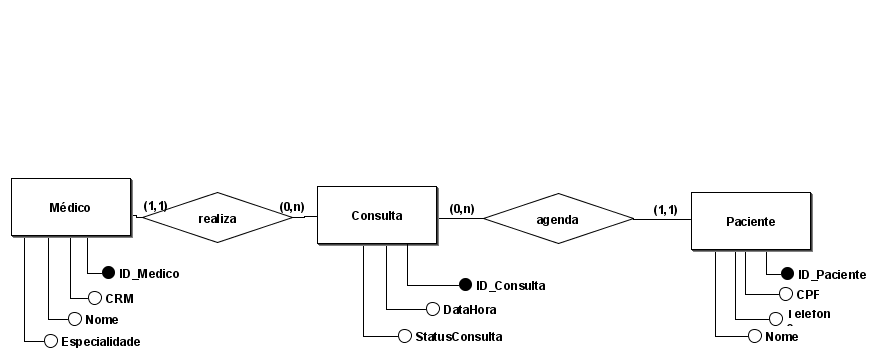

# 🏥 FilaZero — Sistema de Gestão de Filas para Clínicas Médicas

Sistema de linha de comando desenvolvido em **C/C++** com integração nativa ao **Microsoft SQL Server via ODBC** para gerenciamento de filas de espera e registro de atendimentos em clínicas médicas.

Projeto desenvolvido no **PIM IV (Projeto Integrado Multidisciplinar)** do Curso Superior de Tecnologia em Análise e Desenvolvimento de Sistemas da **UNIP EaD (2026)**, integrando **Engenharia de Software Ágil**, **Programação Estruturada em C** e **Modelagem de Banco de Dados Relacional**.

---

## 🧠 Arquitetura Híbrida

O FilaZero combina duas camadas complementares de armazenamento para unir agilidade no atendimento e confiabilidade no histórico clínico:

- **Memória Volátil (RAM em C):** Gerencia em tempo real a ordem de chegada na sala de espera seguindo o princípio **FIFO (*First In, First Out*)**. Originalmente concebida com listas encadeadas e alocação dinâmica, a fila foi refatorada para um vetor sequencial estático (`Paciente fila[100]`) com contador (`totalNaFila`), eliminando riscos de *memory leaks* e simplificando a manutenção.
- **Memória Permanente (SQL Server via ODBC):** Mantém de forma persistente o cadastro de pacientes, o corpo clínico e o histórico de consultas na instância local `.\SQLEXPRESS` com autenticação integrada do Windows (`Trusted_Connection=yes`).

---

## 🚀 Funcionalidades

- **Cadastro e Enfileiramento (Recepção):** Registra nome completo, CPF e telefone do paciente no SQL Server (`salvarPacienteNoBanco`) e o insere automaticamente na fila de espera (`enfileirar`).
- **Chamada de Pacientes (Atendimento Médico):** Lista os médicos disponíveis (`listarMedicos`), chama o primeiro paciente da fila (`desenfileirar`), reorganiza a fila em memória e registra automaticamente a consulta no banco (`registrarConsultaNoBanco`) com data/hora (`GETDATE()`) e status `"Em Atendimento"`.
- **Visualização da Sala de Espera:** Exibe em tempo real a ordem ordinal dos pacientes aguardando atendimento (`mostrarFila`).
- **Consulta de Registros (Gestão Administrativa):** Lista todos os pacientes cadastrados diretamente da base de dados (`listarPacientesBanco`).

---

## 🗄️ Modelagem do Banco de Dados

O banco relacional `FilaZero` é composto por três tabelas interligadas com integridade referencial:



| Tabela | Colunas Principais | Papel no Sistema |
| :--- | :--- | :--- |
| **Pacientes** | `ID_Paciente` (PK, Identity), `Nome`, `CPF` (Unique), `Telefone` | Armazena os dados cadastrais permanentes dos pacientes. |
| **Medicos** | `ID_Medico` (PK, Identity), `Nome`, `CRM` (Unique), `Especialidade` | Mantém o cadastro do corpo clínico disponível para atendimento. |
| **Consultas** | `ID_Consulta` (PK, Identity), `DataHora`, `StatusConsulta`, `ID_Paciente` (FK), `ID_Medico` (FK) | Tabela associativa que vincula paciente e médico na data e hora da chamada. |

Para higienização da base entre testes, o script `database/utils_reset.sql` remove os registros respeitando a hierarquia das chaves estrangeiras (`Consultas` → `Pacientes`) e reinicia os contadores com `DBCC CHECKIDENT`, preservando a tabela `Medicos`.

---

## 📋 Gestão Ágil (Scrum & Kanban)

O desenvolvimento foi organizado em **3 Sprints incrementais** acompanhadas em quadro **Kanban no Trello** (*A Fazer*, *Em Andamento* e *Concluído*):

1. **Sprint 1 — Fundação de Dados:** Criação do banco `FilaZero` no SQL Server Express e implementação das tabelas relacionais com chaves estrangeiras.
2. **Sprint 2 — Núcleo em Linguagem C:** Construção do menu interativo e validação da estrutura de fila FIFO em memória no Dev-C++.
3. **Sprint 3 — Integração e Refinamento:** Conexão C + SQL Server via ODBC (`sqlext.h`), geração automática de consultas com seleção dinâmica do médico e scripts SQL de manutenção.

---

## 🛠️ Tecnologias Utilizadas

- **Linguagem:** C / C++ (`stdio.h`, `stdlib.h`, `string.h`)
- **Integração:** API ODBC para Windows (`windows.h`, `sqlext.h`)
- **Banco de Dados:** Microsoft SQL Server (`SQLEXPRESS`)
- **Modelagem e Gestão:** brModelo (DER Conceitual), SSMS (Modelo Relacional) e Trello (Kanban)

---

## 📂 Estrutura do Repositório

```text
filazero/
├── database/
│   ├── schema.sql                # Criação do banco, tabelas e dados iniciais de teste
│   └── utils_reset.sql           # Script auxiliar de consultas e reset de IDs (DBCC CHECKIDENT)
├── docs/
│   ├── diagrama-er.png           # Imagem do Diagrama Entidade-Relacionamento (DER)
│   ├── documentacao-filazero.pdf # Documentação completa (Casos de Uso, Kanban, DER e Testes)
│   └── modelo_conceitual.brM3    # Arquivo editável do DER no brModelo
├── src/
│   └── main.cpp                  # Código-fonte principal (Fila FIFO + integração ODBC)
└── README.md
```

📄 **[Acessar a documentação completa do projeto (PDF)](docs/documentacao-filazero.pdf)**

---

## ⚙️ Como Compilar e Executar

> **Nota:** Por boas práticas de versionamento, o executável compilado (`.exe`) não é mantido no repositório. Siga os passos abaixo para compilar a partir do código-fonte.

### Pré-requisitos
- Sistema operacional **Windows**
- **Microsoft SQL Server Express** instalado e em execução (`.\SQLEXPRESS`)
- Compilador **MinGW / GCC** (ou **Dev-C++** / Visual Studio)

### 1. Configure o Banco de Dados
Execute o script `database/schema.sql` no **SQL Server Management Studio (SSMS)** para criar o banco `FilaZero`, as tabelas e os dados iniciais de teste.

### 2. Compile o Código-Fonte
No terminal (na raiz do projeto), compile linkando a biblioteca `odbc32`:

```bash
g++ src/main.cpp -o filazero -lodbc32
```

*(Caso utilize o **Dev-C++**, abra `src/main.cpp` e adicione `-lodbc32` em **Opções do Compilador → Linker**.)*

### 3. Execute a Aplicação
```bash
./filazero
```

---

## 👥 Autoria

- **Gabriel Oliveira Barreto** — [LinkedIn](https://www.linkedin.com/in/gabrielbarretodev/) | [GitHub](https://github.com/devgabrielbarreto)
- **Luciana Moreira Gonzaga**
- **Orientação:** Prof. Me. José Lorandi — UNIP EaD (Campinas - SP, 2026)
